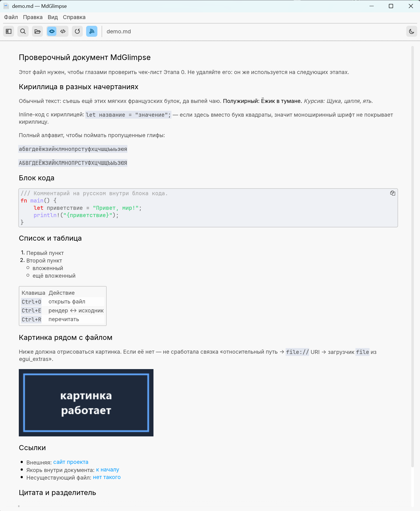
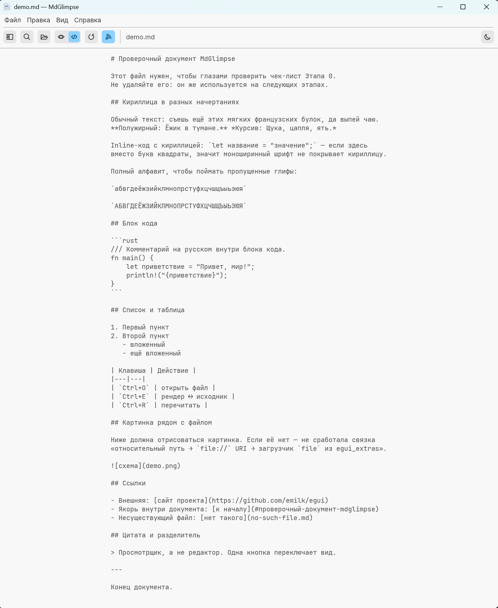
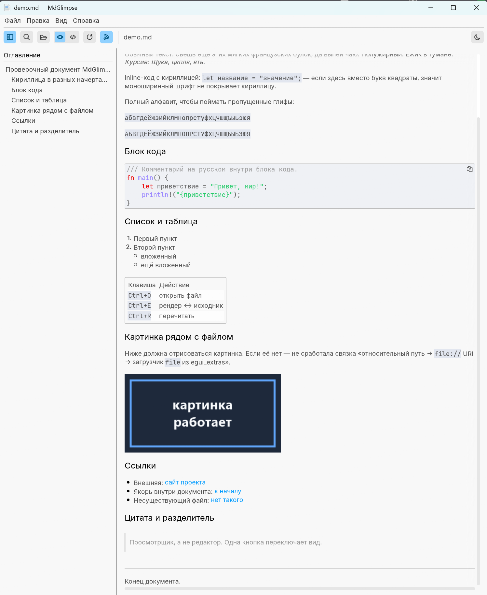
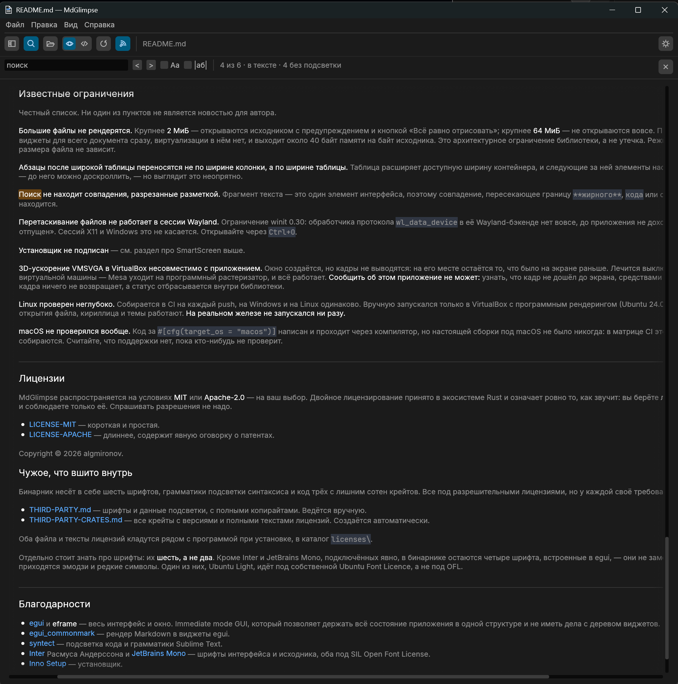

# MdGlimpse

**A lightweight desktop Markdown viewer for Windows and Linux — read the rendered document or inspect its source with one shortcut.**

[**Русская документация / Full Russian documentation**](README.ru.md)

[](https://github.com/algmironov/MdGlimpse/actions/workflows/ci.yml)
[](https://github.com/algmironov/MdGlimpse/releases)


MdGlimpse is a **viewer, not an editor**. Open a Markdown file, see how it looks, and switch to the source with `Ctrl+E`. No account, advertising, or embedded browser. The project is under active improvement.

## Screenshots

| Rendered document | Source view |
|---|---|
|  |  |
| Table of contents | Search |
|  |  |

## Features

- Switch between rendered Markdown and source (`Ctrl+E`).
- Syntax highlighting for fenced code blocks (75 languages).
- Navigable document outline and current-section highlighting.
- Search with highlighting in rendered and source views.
- Load relative and absolute image paths.
- Optional file watching to refresh a document edited elsewhere.
- Light and dark themes, Cyrillic text support, recent files, and remembered layout.
- Open other text formats in source mode; binary files are rejected.
- Optional file association through the operating system's **Open with** mechanism.

## Download and install

Get published builds from [GitHub Releases](https://github.com/algmironov/MdGlimpse/releases).

| Artifact | Platform / purpose |
|---|---|
| `mdglimpse-X.Y.Z-setup.exe` | Windows installer; per-user installation, no administrator rights required |
| `mdglimpse-X.Y.Z-windows-x64.exe` | Portable Windows x64 executable |
| `mdglimpse-X.Y.Z-linux-x64.tar.gz` | Linux x86-64 (glibc) |

**Windows SmartScreen:** The installer is not code-signed and may show a reputation warning. Only download builds from the official Releases page, and verify checksums before running unfamiliar binaries. SHA-256 values are published with releases and in `SHA256SUMS.txt`.

On Windows, check a downloaded file with:

```powershell
Get-FileHash .\mdglimpse-X.Y.Z-setup.exe -Algorithm SHA256
```

On Linux, where applicable:

```bash
sha256sum -c SHA256SUMS.txt
```

The release workflow also prints checksums in the public [Actions logs](https://github.com/algmironov/MdGlimpse/actions).

## Build from source

Requires **Rust 1.95 or newer**.

```bash
cargo run --release -- samples/demo.md
```

Or open your own document:

```bash
cargo run --release -- path/to/document.md
```

The first build can take some time because syntax highlighting includes a substantial dependency set.

On Debian/Ubuntu, the documented build prerequisites are:

```bash
sudo apt install build-essential pkg-config \
    libx11-dev libxcursor-dev libxrandr-dev libxi-dev \
    libgl1-mesa-dev libxkbcommon-dev libwayland-dev
```

For the Windows installer, install [Inno Setup 6](https://jrsoftware.org/isinfo.php) and run:

```powershell
cargo build --release
iscc installer\mdglimpse.iss
```

See the [full Russian documentation](README.ru.md) for installer naming, license notices, `cargo-about`, and packaging details.

## Keyboard shortcuts

| Shortcut | Action |
|---|---|
| `Ctrl+O` | Open a file |
| `Ctrl+E` | Toggle rendered view / source |
| `Ctrl+R` | Reload |
| `Ctrl+B` | Toggle outline |
| `Ctrl+F` | Search |
| `F3` / `Shift+F3` | Next / previous match |
| `Ctrl+A`, `Ctrl+C` | Select all / copy |
| `Ctrl + +`, `Ctrl + -`, `Ctrl+0` | Zoom |
| `Shift` + mouse wheel | Horizontal scroll |

## Known limitations and platform status

These are documented limitations, not claims of complete cross-platform support.

- **Large files:** Above 2 MiB, documents open in source mode by default with an option to render anyway. Files above 64 MiB are rejected. Rendering is not virtualized; source view is.
- **Wide tables:** Text after a wide table may wrap to the table's width instead of the visible column.
- **Search:** Matches split across formatting boundaries (such as bold text or inline code) may not be found.
- **Wayland:** Drag-and-drop is not supported by the current windowing backend; use `Ctrl+O`.
- **VirtualBox VMSVGA:** 3D acceleration can prevent frames from displaying; disabling it can work around the issue.
- **Linux:** CI builds run on Linux, and limited manual testing was performed in Ubuntu 24.04 inside VirtualBox. It has **not** been validated on physical Linux hardware.
- **macOS:** Not tested or included in release builds. Do not assume macOS support.
- **Windows installer:** Not code-signed.

The detailed explanations and workarounds are in [README.ru.md](README.ru.md).

## Development checks

```bash
cargo fmt --check
cargo clippy --all-targets -- -D warnings
cargo test
cargo build --release
cargo tree -d
```

CI runs relevant checks on Windows and Linux. Some registry-related tests are intentionally excluded from CI because they modify the current user's Windows registry.

## Licenses and acknowledgements

MdGlimpse is dual-licensed under **MIT OR Apache-2.0**. Choose either license:

- [MIT license](LICENSE-MIT)
- [Apache-2.0 license](LICENSE-APACHE)

Third-party notices are documented in [THIRD-PARTY.md](THIRD-PARTY.md) and [THIRD-PARTY-CRATES.md](THIRD-PARTY-CRATES.md).

Built with [egui / eframe](https://github.com/emilk/egui), [egui_commonmark](https://github.com/lampsitter/egui_commonmark), and [syntect](https://github.com/trishume/syntect). Uses Inter and JetBrains Mono fonts and Inno Setup for Windows packaging.

## More documentation

- [README.ru.md](README.ru.md) — full original Russian documentation, including detailed technical notes and limitations.
- [NOTES.md](NOTES.md) — implementation notes.
- [ROADMAP.md](ROADMAP.md) — progress and planned work.

Copyright © 2026 algmironov.
